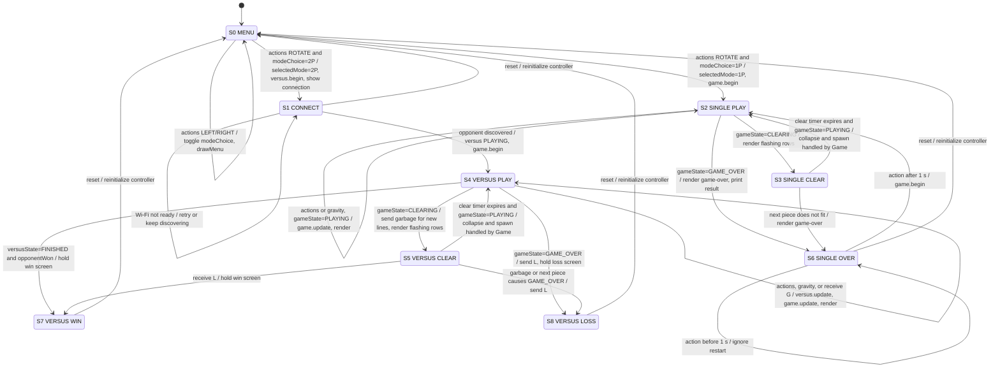

# Main control module state machine

This is the detailed FSM for the main control module in
[`tetris_r4.ino`](./tetris_r4/tetris_r4.ino). The module reads buttons and
Serial input, coordinates [`Game`](./tetris_r4/TetrisGame.h) and
[`VersusGame`](./tetris_r4/VersusGame.h), and updates the LED matrix.

The FSM deliberately has one state variable, `controlState`, instead of
combining the menu, connection, gameplay, and end-of-game behavior into
several independent state machines. `Game::State` and
`VersusGame::State` are treated as inputs from the two lower-level modules.

## Interface and state variables

### Inputs

| Input | Meaning |
|---|---|
| `reset` | Board reset/power-up event. Re-enters the mode menu. |
| `actions` | Debounced button/Serial bit mask: `A_LEFT`, `A_RIGHT`, `A_ROTATE`, `A_DOWN`, `A_DROP`. |
| `now` | Current millisecond timestamp from `millis()`. |
| `gameState` | State reported by `Game`: `PLAYING`, `CLEARING`, or `GAME_OVER`. |
| `gameLines` | Total lines cleared by the local `Game`. |
| `versusState` | State reported by `VersusGame`: `CONNECTING`, `PLAYING`, or `FINISHED`. |
| `opponentWon` | Indicates that a received `L` packet means this board won. |
| `wifiStatus` / UDP packets | Connection and opponent-discovery/network events consumed by `VersusGame`. |

### Outputs

| Output | Meaning |
|---|---|
| `drawMenu()` | Display the current 1P/2P menu choice. |
| `showVersusConnection()` | Display the waiting-for-opponent screen. |
| `game.begin(now, random)` | Initialize or restart the local game. |
| `game.update(now, actions)` | Apply the current input to the local game. |
| `game.render(now, rows)` / `drawRows(rows)` | Render gameplay, line-clear animation, or game-over score. |
| `versus.begin(now, random)` / `versus.update(now, game)` | Start and service Versus networking. |
| `versus.sendGarbage(count)` | Send one garbage row per newly cleared line. |
| `versus.sendLoss()` | Notify the opponent that this board lost. |
| Serial messages | Report mode, connection, line-clear, and win/loss events. |

### State variables and initialization

| Variable | Initialization | Purpose |
|---|---|---|
| `controlState` | `S0_MENU` during `setup()` | Current main FSM state; `S0_MENU` is the start state. |
| `modeChoice` | `MODE_SINGLE` / `menuChoiceVersus = false` | Current menu selection. Left/right toggles it. |
| `selectedMode` | `MODE_SINGLE` | Mode used after menu confirmation. |
| `reportedLines` | `0` | Last local line count reported to the opponent. |
| `game` | Constructed, then initialized by `game.begin()` | Local board, piece, score, and game state. |
| `versus` | Constructed, then initialized by `versus.begin()` only in 2P mode | Wi-Fi, UDP, opponent, and network state. |

`reset` is handled as a re-entry event: it clears/reinitializes the
controller variables, calls `game.begin()`, and returns to `S0_MENU`.

## Main control FSM

States are numbered and named concisely:

- **S0 MENU** — choose 1P or 2P.
- **S1 CONNECT** — wait for a Versus opponent.
- **S2 SINGLE PLAY** — run the local game in single-player mode.
- **S3 SINGLE CLEAR** — show the local line-clear animation.
- **S4 VERSUS PLAY** — run the local game and network service.
- **S5 VERSUS CLEAR** — show the line-clear animation while networking remains active.
- **S6 SINGLE OVER** — show game-over output and wait for restart.
- **S7 VERSUS WIN** — opponent reported loss; hold until reset.
- **S8 VERSUS LOSS** — local game reached game-over; hold until reset.

## Design notes

1. `S0_MENU` is the start state after reset. The initial display is the 1P
   choice because `menuChoiceVersus` is initialized to `false`.
2. `S1_CONNECT` does not call `game.update()` until an opponent is found.
   This matches the implementation: the board shows the connection screen
   while `VersusGame` handles Wi-Fi retry and UDP discovery.
3. In `S4_VERSUS_PLAY` and `S5_VERSUS_CLEAR`, each increase in
   `gameLines` above `reportedLines` produces `versus.sendGarbage(delta)`,
   then `reportedLines` is updated.
4. The lower-level `Game` state transitions are internal details of the
   `S2`–`S6` and `S4`–`S8` controller states: piece movement and gravity stay
   in `PLAYING`, line flashing stays in `CLEARING`, and a full board enters
   `GAME_OVER`.
